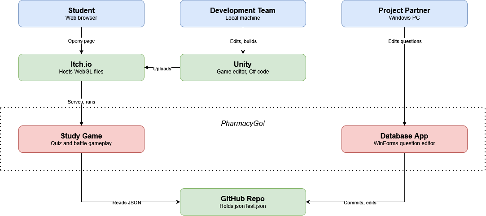
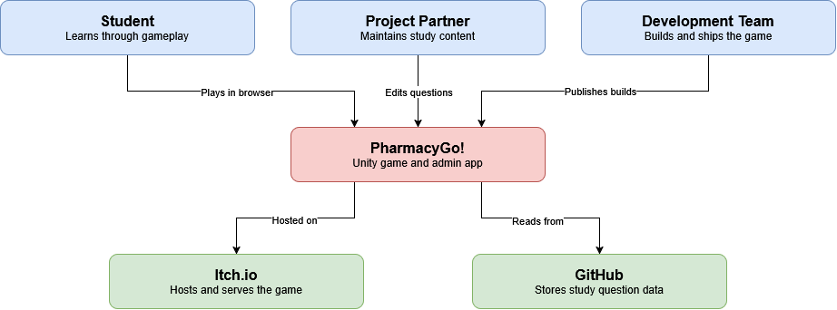

# Design

## Overview
PharmacyGo! is a study game for OSU PHAR736 students, developed in Unity and hosted on 
[Itch](https://abloomis.itch.io/pharmacy-go-v3) for players to access at any time. A [WinForms C# app](https://github.com/kyofyufufufufufufufu/test_database1) manages database integration, allowing the project partner to dynamically edit the study questions used by the game.

## Architecture

- Game Engine (Unity, WebGL): overworld, battles, quiz gameplay, runs in the student's browser.
- Admin App (C#, WinForms): edit, save, and bulk upload study questions, commits to GitHub via GitHub API.
- Question Data: [jsonTest.json](https://github.com/kyofyufufufufufufufu/test_database1/blob/main/jsonTest.json) loaded in by the admin app.
- Itch.io: hosts and serves the WebGL build.

## Interfaces
- Question set schema: JSON, defined by the [QuestionSet](https://github.com/kyofyufufufufufufufu/test_database1/blob/main/DataModels.cs) C# class, updating this requires updating both apps.
- GitHub API: the admin app fetches and commits using a token, which is read by the game. 

## Data
- JSON file in git
- Player save data saved in browser storage via IndexedDB

## Deployment
- Game: Unity WebGL build uploaded to [Itch.io](https://abloomis.itch.io/pharmacy-go-v3) manually, public access.
- Admin app: csv or xslx file uploaded manually.
- Rollback: re-upload the previous build to Itch.

## Open questions
- Movement: change to tile-based, or keep free + diagonal movement?
- Art: use a unified palette across the whole game? Use natively-sized pixel art for the entire game, including fonts and UI?
- Battles: how can we incorporate animations into battle UI?
- Save data: create manual-save and manual-load options (i.e. save a hash to a txt file)?

## Deferred decisions
- Character customization: best approach (palette swap, different sprites) and how choices are saved.
- Backend: using GitHub tokens may be limiting if player volume or rate limits increase.
- Custom Tilesets: current tilesets are all free + open-source assets.
